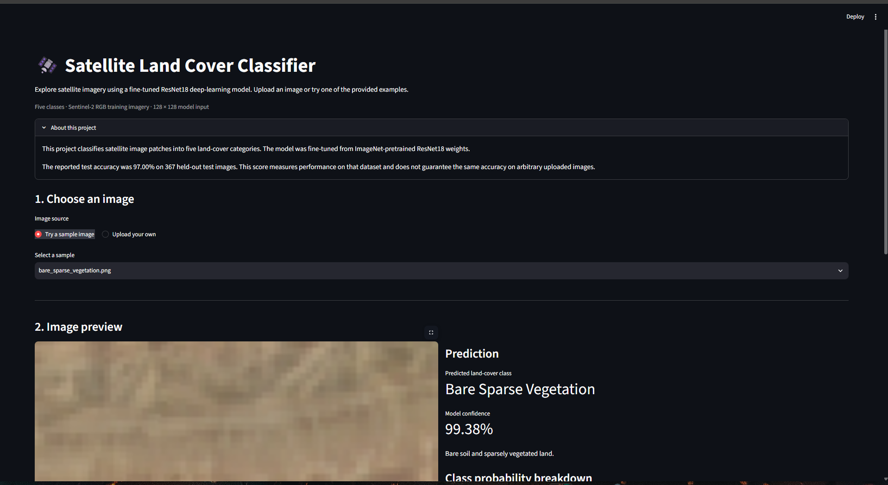
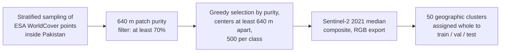
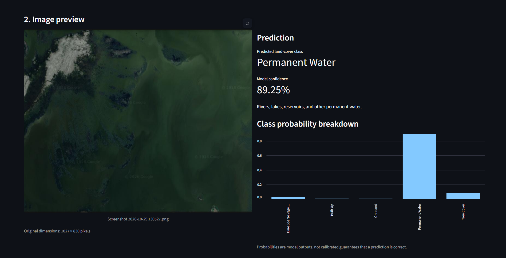

# Satellite-Based Land-Cover Classification Using Transfer Learning

Classifies Sentinel-2 satellite imagery into five land-cover categories using ResNet-18, trained on patches from across Pakistan and served through a Streamlit web app.     
Note: The dataset was produced by the author of this repo using Google Earth API

[**Live demo**](https://satellite-landcover-classifier.streamlit.app/) · [Dataset on Kaggle](https://www.kaggle.com/datasets/zimransohail/satellite-land-cover-classification) · [Dataset on Google Drive](https://drive.google.com/drive/folders/1pbd0O_leqiqgH5Fl_mIwgITlKaM3ycgP?usp=sharing)



## Highlights

- **97.00% test accuracy** (356/367) with a fine-tuned, ImageNet-pretrained ResNet-18.
- A custom dataset of **2,500 Sentinel-2 patches** (500 per class, 640 m × 640 m each), sampled across Pakistan and labeled from ESA WorldCover 2021.
- Leakage-aware splitting: patches are grouped into geographic clusters, and each cluster belongs to exactly one of train, validation, or test.
- Three training strategies compared on the same data: from scratch, frozen pretrained backbone, and full fine-tuning.
- Deployed Streamlit app that shows the predicted class, confidence, and per-class probabilities.

## Contents

- [Land-cover classes](#land-cover-classes)
- [Dataset](#dataset)
- [Models and training](#models-and-training)
- [Results](#results)
- [Streamlit app](#streamlit-app)
- [Run locally](#run-locally)
- [Use the model in Python](#use-the-model-in-python)
- [Reproducing the experiments](#reproducing-the-experiments)
- [Repository structure](#repository-structure)
- [Limitations](#limitations)
- [Future work](#future-work)
- [Data sources and licenses](#data-sources-and-licenses)
- [Author](#author)

## Land-cover classes

| WorldCover code | Class | Folder / config name |
| --------------- | ------------------------ | ---------------------- |
| 10 | Tree Cover | `Tree_Cover` |
| 40 | Cropland | `Cropland` |
| 50 | Built-up | `Built_Up` |
| 60 | Bare / Sparse Vegetation | `Bare_Sparse_Vegetation` |
| 80 | Permanent Water | `Permanent_Water` |

## Dataset

### How the dataset was built



1. **Candidate sampling.** Points were drawn with stratified sampling from ESA WorldCover v200 inside Pakistan's national boundary (FAO GAUL), covering the five target classes. A large nationwide pool was sampled first, then regional top-up sampling (Northern Pakistan, Upper, Central and Lower Punjab, and Sindh) was used for classes that fell short of 500.
2. **Purity filter.** A 640 m × 640 m square was placed around each point, and the patch was kept only if at least 70% of its 10 m WorldCover pixels belonged to the sampled class.
3. **Spatial spacing.** Patches were selected greedily from highest to lowest purity, requiring every selected center to be at least 640 m from all previously selected centers, until each class reached 500 patches.
4. **Imagery.** Each patch is a Sentinel-2 RGB image (B4, B3, B2) from Google Earth Engine, built as a cloud-masked median composite of 2021 (details below).
5. **Geographic grouping and splitting.** Patch locations were clustered into 50 geographic groups with k-means. Whole groups were assigned to train, validation, or test, using a search that targeted roughly a 70/15/15 split with balanced classes.
6. **Alignment.** The released 128 × 128 dataset uses the same split assignments as the initial 64 × 64 export (the "aligned" dataset), so image size is the only difference between the two.

### Dataset summary

| Split | Images |
| ---------- | --------: |
| Training | 1,766 |
| Validation | 367 |
| Testing | 367 |
| **Total** | **2,500** |

Each class has exactly 500 images in total. Test-set class counts are listed in the [per-class results](#per-class-results-fine-tuned-model).

### Imagery processing

| Setting | Value |
| ------------------- | ----- |
| Source collection | `COPERNICUS/S2_SR_HARMONIZED` (Sentinel-2 surface reflectance) |
| Date range | 1 January 2021 to 1 January 2022 |
| Scene filter | Scene-level cloud cover below 30% |
| Pixel cloud mask | Scene Classification Layer; removes no-data, saturated or defective pixels, cloud shadows, medium and high probability clouds, thin cirrus, and snow or ice |
| Composite | Median over the year |
| Bands | B4 (red), B3 (green), B2 (blue) |
| Visualization | Reflectance 0 to 3000 stretched to 8-bit, gamma 1.2 |
| Patch size | 640 m × 640 m |
| Export size | 128 × 128 PNG |

The bands have a native resolution of 10 m per pixel, so a 640 m patch contains about 64 × 64 native pixels. The 128 × 128 export is resampled by Earth Engine and does not add real spatial detail.

The full workflow is in [`Dataset_generation.ipynb`](Dataset_generation.ipynb).

## Models and training

All three models are ResNet-18 (torchvision) with the final layer replaced by a five-class linear layer. Common settings: 128 × 128 input, batch size 32, cross-entropy loss, random horizontal and vertical flips for training only, ImageNet normalization, seed 42, and checkpoint selection by best validation accuracy with early stopping.

| | From scratch | Frozen pretrained | Fine-tuned pretrained |
| ---------------- | ------------ | ----------------- | --------------------- |
| Initialization | Random | ImageNet weights | Best frozen-backbone checkpoint |
| Trainable layers | All | New classification head only (BatchNorm kept in eval mode) | All |
| Optimizer | AdamW, weight decay 1e-4 | AdamW, weight decay 1e-4 | AdamW, weight decay 1e-4 |
| Learning rate | 1e-3 | 1e-3 | 1e-5 backbone, 1e-4 head |
| LR schedule | Reduce on plateau (validation accuracy, factor 0.5, patience 2) | Constant | Reduce on plateau (validation accuracy, factor 0.5, patience 2) |
| Max epochs / early-stopping patience | 20 / 5 | 15 / 4 | 15 / 4 |

<!-- TODO: confirm the "From scratch" column matches the run that produced 92.80% validation and 95.10% test accuracy. The notebook contains two scratch runs (64x64 images resized to 224 with Adam, and 128x128 with AdamW). -->

The training workflow is in [`Land_Cover_classifier.ipynb`](Land_Cover_classifier.ipynb).

## Results

| Experiment | Best validation accuracy | Test accuracy |
| ----------------------------------- | -----------------------: | -------------------: |
| ResNet-18 trained from scratch | 92.80% | 95.10% (349/367) |
| Frozen pretrained ResNet-18 | 95.37% | 95.37% (350/367) |
| **Fine-tuned pretrained ResNet-18** | **95.91%** | **97.00% (356/367)** |

Fine-tuning achieved the highest test accuracy, 6 images better than the frozen backbone and 7 better than training from scratch. With 367 test images, each image is worth about 0.27 percentage points, and the approximate 95% confidence interval for the fine-tuned model's accuracy is 94.7% to 98.3% (Wilson interval). The intervals of the three models overlap, so these results suggest, but do not prove, that transfer learning helps on this dataset.

### Per-class results (fine-tuned model)

| Class | Precision | Recall | F1-score | Test images |
| ------------------------ | --------: | -------: | -------: | ----------: |
| Bare / Sparse Vegetation | 97.50% | 100.00% | 98.73% | 78 |
| Built-up | 98.55% | 100.00% | 99.27% | 68 |
| Cropland | 91.78% | 95.71% | 93.71% | 70 |
| Permanent Water | 98.73% | 97.50% | 98.11% | 80 |
| Tree Cover | 98.48% | 91.55% | 94.89% | 71 |
| **Macro average** | | | **96.94%** | |
| **Weighted average** | | | **97.00%** | **367** |

The model made 11 errors on the test set. Six of them were Tree Cover images, and Cropland was the most common wrong prediction (6 of the 11). This fits the nature of the data: many patches mix fields, scattered trees, and other vegetation, and a patch only needs 70% purity to be included.

<!-- TODO: add the confusion matrix image (screenshots/confusion_matrix.png) from Subsection 5.4 and a few misclassified examples. -->

### Qualitative checks

`Land_Cover_classifier.ipynb` also includes a visual check on 15 random test images (3 per class) with coordinates and Google Earth links, so predictions can be compared against the real locations.

## Streamlit app

Upload an image to see the predicted class, the confidence score, and the probability of each class. Try the [live demo](https://satellite-landcover-classifier.streamlit.app/), or use the images in [`sample_images/`](sample_images/).

**Example: lake screenshot from Google Earth**



Confidence is the model's predicted probability for a class, not a guarantee of correctness. The model was trained on Sentinel-2 RGB composites produced with the specific procedure described in [Imagery processing](#imagery-processing). Google Earth screenshots differ in color, scale, acquisition date, and processing, so predictions on them are demonstrations rather than accuracy evaluations.

## Run locally

**Requirements:** Python 3 and pip. Dependencies (listed in `requirements.txt`): `streamlit`, `torch`, `torchvision`, `Pillow`, `pandas`. The repository already includes `model_weights.pth` and `config.json`.

<!-- TODO: state the Python version you tested with, and consider pinning package versions in requirements.txt (pip freeze). -->

```bash
# 1. Clone
git clone https://github.com/ZimranSohail/Land-Cover-Classifier.git
cd Land-Cover-Classifier

# 2. Create a virtual environment
python -m venv .venv
source .venv/bin/activate          # Linux / macOS
# .venv\Scripts\Activate.ps1       # Windows PowerShell

# 3. Install dependencies
python -m pip install --upgrade pip
pip install -r requirements.txt

# 4. Start the app
streamlit run app.py
```

The app opens in your browser, usually at `http://localhost:8501`. If PowerShell blocks activation, use Command Prompt or call the environment's Python executable directly.

## Use the model in Python

A minimal example that loads the exported weights and classifies one image (the app's own logic is in `inference.py`):

```python
import json
import torch
from PIL import Image
from torchvision import models, transforms

cfg = json.load(open("config.json"))

model = models.resnet18(weights=None)
model.fc = torch.nn.Linear(model.fc.in_features, cfg["num_classes"])
model.load_state_dict(
    torch.load("model_weights.pth", map_location="cpu", weights_only=True)
)
model.eval()

preprocess = transforms.Compose([
    transforms.Resize(tuple(cfg["input_size"])),
    transforms.ToTensor(),
    transforms.Normalize(cfg["normalization"]["mean"], cfg["normalization"]["std"]),
])

image = Image.open("sample_images/cropland.png").convert("RGB")
with torch.no_grad():
    probs = torch.softmax(model(preprocess(image).unsqueeze(0)), dim=1)[0]

print(cfg["class_names"][probs.argmax()], f"{probs.max():.1%}")
```

## Reproducing the experiments

Both notebooks were written for Google Colab and use Google Drive for storage.

- **Dataset generation** needs a Google Earth Engine account and your own Google Cloud project ID (set `PROJECT_ID` in the notebook).
- **Training** only needs the dataset. You can skip dataset generation by downloading it from [Kaggle](https://www.kaggle.com/datasets/zimransohail/satellite-land-cover-classification) or [Google Drive](https://drive.google.com/drive/folders/1pbd0O_leqiqgH5Fl_mIwgITlKaM3ycgP?usp=sharing). The notebook expects the aligned 128 × 128 images in `train/`, `val/`, and `test/` folders with one subfolder per class.
- Drive paths (`PROJECT_DIR` and the dataset folders) are hard-coded; update them to match your setup.

## Repository structure

```text
Land-Cover-Classifier/
├── Dataset_generation.ipynb      # Sampling, purity filtering, splitting, image export (Earth Engine)
├── Land_Cover_classifier.ipynb   # Training, evaluation, and model export
├── app.py                        # Streamlit interface
├── inference.py                  # Model loading, preprocessing, prediction
├── config.json                   # Class names, input size, normalization, test accuracy
├── model_weights.pth             # Fine-tuned model weights
├── requirements.txt
├── sample_images/                # One example image per class
└── screenshots/                  # Images used in this README
```

## Limitations

- **Geographic and temporal scope.** All patches come from Pakistan and from a single year (2021). Performance in other countries, climates, or years has not been tested.
- **Labels are not field-verified.** Labels come from ESA WorldCover, which is itself a model-derived product. A patch is kept if at least 70% of its pixels match the label, so patches can contain up to 30% of other classes. Reported accuracy measures agreement with WorldCover, not independent ground truth.
- **Annual median composites.** Training images are cloud-masked yearly medians, not single-date images. Single-date images and screenshots can look quite different (season, haze, color processing).
- **Resolution.** Patches have about 64 × 64 native pixels, upsampled to 128 × 128. Small features are not resolved.
- **RGB only.** Near-infrared and other bands were not used, which may limit separation of Cropland and Tree Cover.
- **Small test set.** The test set has 367 images (95% interval for the best model: about 94.7% to 98.3%).
- **Split design.** Whole geographic clusters are kept in one split, which reduces leakage, but patches near a cluster boundary can still be close to patches in another split. Patch centers are at least 640 m apart, but diagonal neighbors can overlap slightly.
- **Out-of-distribution inputs.** Predictions on unrelated screenshots can be wrong even with high confidence.

## Future work

- Add the confusion matrix and an error analysis of misclassified patches.
- Evaluate on an independent external dataset (other regions, other years).
- Test additional bands (NIR, SWIR) and multi-temporal inputs.
- Compare other pretrained architectures.
- Add a FastAPI endpoint for programmatic predictions.
- Add automated tests for preprocessing and inference.

## Data sources and licenses

- Imagery: contains modified Copernicus Sentinel-2 data (2021), accessed through Google Earth Engine.
- Labels: ESA WorldCover 2021 v200, licensed CC BY 4.0.
- Country boundary: FAO GAUL 2015.
- Code license: <!-- TODO: add a LICENSE file (e.g. MIT) and name it here. -->

## Author

**Zimran Sohail**

Built with Python, PyTorch, Torchvision, Google Earth Engine, Streamlit, and Pillow.
